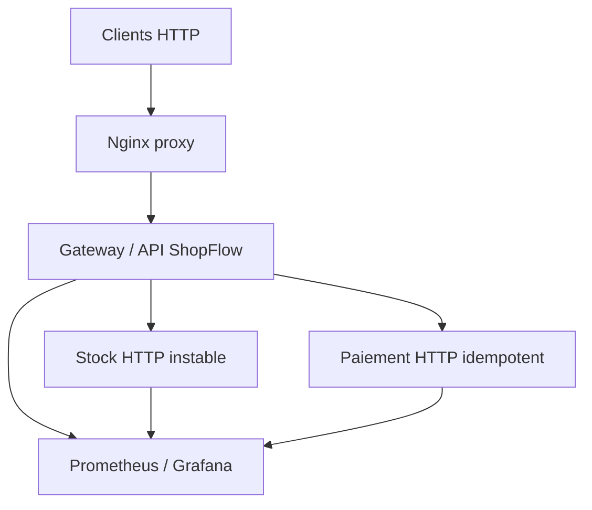

# ShopFlow Final — architecture résiliente complète


**Démarrage en une commande** (Docker Desktop / Docker Compose) :

```bash
docker compose up -d --build --scale gateway=2
```

Sous Windows avec WSL, exécuter la commande depuis le dossier `ShopFlow_Projet_Final` après avoir démarré Docker Desktop.

| Accès | Adresse |
| --- | --- |
| Catalogue | http://localhost:8000/catalogue |
| Commande | `POST http://localhost:8000/checkout` |
| Prometheus | http://localhost:9090 |
| Grafana | http://localhost:3000 (admin / demo-change-me) |


## Démonstration rapide

```bash
docker compose ps
curl -i http://localhost:8000/catalogue
curl -i -X POST http://localhost:8000/checkout \
  -H 'Content-Type: application/json' \
  -H 'Idempotency-Key: demo-commande-0001' \
  -H 'X-Client-Id: demo' \
  -d '{"sku":"A1"}'
```

Résultat attendu : code 200 pour le catalogue et la commande lorsque les trois services sont disponibles. Si la commande est répétée avec **la même clé**, le service paiement renvoie le même identifiant et ne crée pas un second débit.

## Architecture



Les appels à `/catalogue` supportent une lecture de cache **dégradée** en cas de panne de stock. Les appels à `/checkout` **n'utilisent jamais un stock périmé pour encaisser** : si la dépendance est indisponible, ils répondent 503. Cette différence est une décision métier de sécurité.

## Patterns intégrés

| Pattern | Paramètre de démonstration | Risque traité |
| --- | --- | --- |
| Timeout | 240 ms par tentative, dépendance HTTP | Service lent et saturation des threads |
| Retry + backoff/jitter | 2 tentatives maximum ; Retry-After respecté ou repli sans retry si délai incompatible | Erreurs temporaires et réponse perdue |
| Circuit breaker | 3 appels en échec ; semi-ouvert après 2 s | Cascade vers une dépendance durablement indisponible |
| Bulkhead | 4 appels concurrents par dépendance | Épuisement de la capacité sur un downstream |
| Fallback / cache stale-if-error | TTL frais 3 s, périmé jusqu'à 90 s | Indisponibilité du stock pour la consultation |
| Dégradation gracieuse | `mode=DEGRADE`, `stock_certified=false` | Mensonge métier sur un stock ancien |
| Rate limiting | 10 jetons initialement, recharge 5/s, par client | Client abusif / surcharge |
| Load shedding | 8 places, 2 réservées aux commandes | Saturation, priorité de `/checkout` |
| Health checks | `/health/live`, `/ready`, `/startup` | Routage vers instance non prête |
| Idempotence paiement | clé HTTP `Idempotency-Key` | Double débit après retry réseau |

Chaque pattern a sa métrique : `shopflow_timeouts_total`, `shopflow_retries_total`, `shopflow_circuit_breaker_rejections_total`, `shopflow_bulkhead_rejections_total`, `shopflow_cache_hits_total`, `shopflow_fallback_total`, `shopflow_rate_limit_rejections_total`, `shopflow_load_shed_rejections_total`, `shopflow_payment_charges_total`, `shopflow_idempotency_replays_total`, les métriques HTTP et les sondes /health.

## Tests et cinq expériences de chaos

Les tests intégrés peuvent tourner sans Docker, sans librairie Python supplémentaire :

```bash
python3 -m unittest discover -s tests -v
python3 chaos/experiment.py --scenarios ABCDE --samples 12 --duration 2
```

Le script démarre/arrête trois serveurs **uniquement sur les ports locaux 18000, 18080, 18081**, réalise chaque scénario une fois sans patterns puis avec patterns, et écrit `results/experiences_locales.json`. Les données mesurées lors de la création figurent aussi dans `docs/experiences.md` et `Dossier_Architecture_ShopFlow.docx`.

## Livraison / fichiers importants

- `shopflow/` : code source des trois services et patterns réutilisables.
- `chaos/experiment.py` : campagne reproductible des 5 pannes.
- `tests/test_patterns.py` : tests unitaires.
- `ops/prometheus.yml`, `ops/alerts.yml` : collecte et règle SLO 99,5 %.
- `ops/grafana/dashboards/shopflow.json` : tableau de bord préchargé.
- `k8s/` : bonus Deployment, Service, probes et PodDisruptionBudget (instructions incluses).
- `results/experiences_locales.json` : preuve brute des tests de panne exécutés localement.


## Nettoyage

```bash
docker compose down
```

Cette commande retire les conteneurs du projet, sans effacer de volumes persistants externes.
